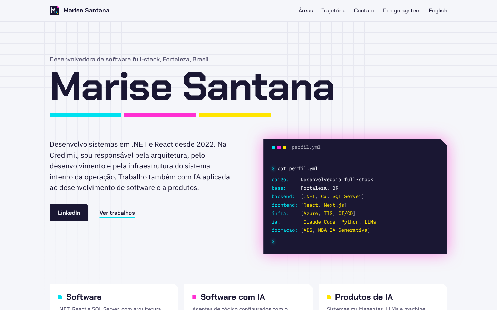
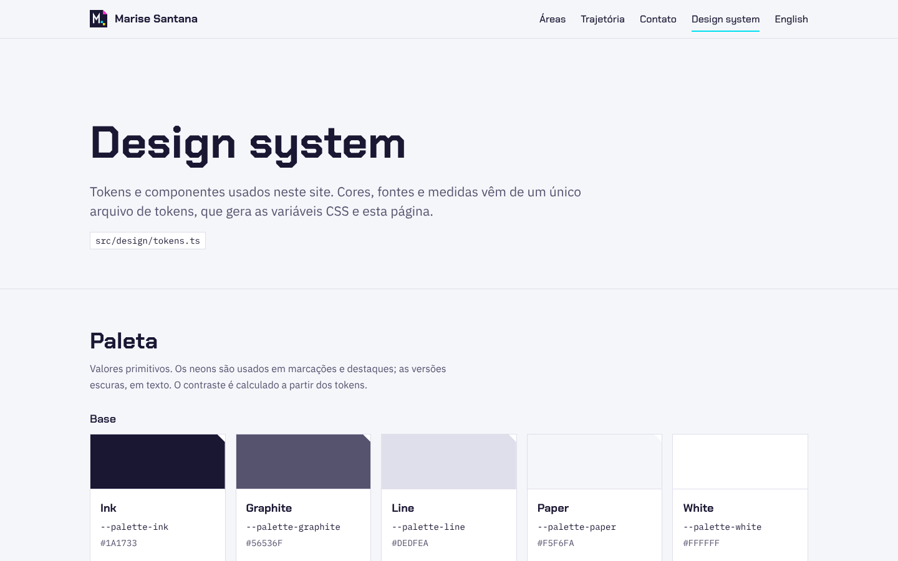
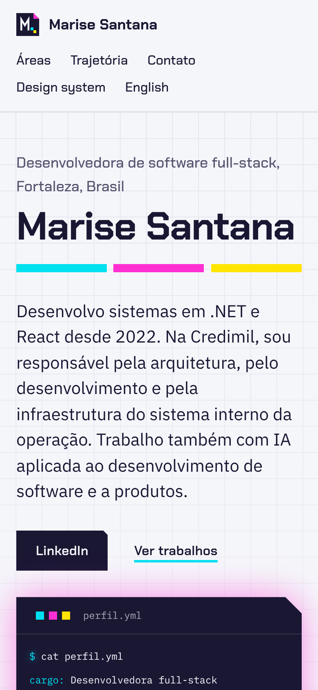

# marisesan.com

Site pessoal e portfólio de **Marise Santana**, desenvolvedora de software full-stack. O site apresenta o trabalho em três áreas: software, software com IA e produtos de IA.

**[marisesan.com](https://marisesan.com)** · [English version](https://marisesan.com/en/) · [Design system](https://marisesan.com/design-system/)



Site estático em [Astro](https://astro.build) e TypeScript, sem nenhum JavaScript no navegador. O visual é feito com HTML e CSS a partir de um design system próprio. O conteúdo é bilíngue, e cada idioma é tipado contra o mesmo contrato.

## Destaques técnicos

**Design tokens como fonte única.** Cores, fontes, escalas, espaçamentos, formas e efeitos ficam em [`src/design/tokens.ts`](src/design/tokens.ts). O layout converte esse arquivo em variáveis CSS, e a página `/design-system` lê o mesmo arquivo para gerar a documentação. Trocar a paleta é editar um objeto.

**Contraste calculado no build.** A página do design system calcula a razão de contraste WCAG de cada cor contra o fundo claro e o escuro, a partir dos próprios tokens ([`src/lib/contrast.ts`](src/lib/contrast.ts)).

**Componentes visuais só com CSS.**

| Componente | Técnica |
|---|---|
| Terminal com digitação | `width` em `ch` animada com `steps()` e linhas reveladas em sequência por `--i` |
| Barra de progresso de leitura | `animation-timeline: scroll()`, com `@supports` como melhoria progressiva |
| Fluxos de etapas | Contadores CSS, conectores em `linear-gradient` + `conic-gradient` e `@container` para virar vertical em espaço estreito |
| Pirâmide de testes | Larguras derivadas do índice e trapézios com `clip-path` |
| Diagrama de camadas | Componente Astro recursivo (`Astro.self`), com a cor ficando mais intensa por `color-mix()` a cada nível |
| Brilho neon | `drop-shadow` no invólucro, para o brilho não ser cortado pelo `clip-path` do canto chanfrado |
| Listas de trabalhos | `:has()` destaca a linha em foco e recua as demais |

**Conteúdo tipado e bilíngue.** Os textos em português e inglês ([`src/content/`](src/content)) seguem a interface `SiteContent`. Se um idioma ficar sem algum campo, o `astro check` falha.

**Acessibilidade.**
- HTML semântico, link para pular ao conteúdo e foco visível em todos os elementos interativos.
- Todas as animações respeitam `prefers-reduced-motion`.
- Texto sobre fundo claro usa apenas cores com contraste AA ou superior.

**SEO.**
- `hreflang` entre os idiomas, URL canônica e Open Graph com imagem por idioma.
- Dados estruturados `Person` (JSON-LD) e sitemap gerado no build.

**Desempenho.**
- Fontes hospedadas no próprio site, com `preload`.
- Nenhum script no cliente; o build completo tem cerca de 440 KB, incluindo fontes e imagens.

<p>
  
  
</p>

## Estrutura

```
src/
├── design/tokens.ts         Fonte única de cores, fontes, escalas, formas e efeitos
├── content/
│   ├── types.ts             Contrato do conteúdo (SiteContent)
│   ├── pt.ts / en.ts        Textos de cada idioma
├── i18n/index.ts            Idiomas, rotas e textos de interface
├── components/
│   ├── ui/                  Button, Tag, AreaMark, Terminal
│   ├── diagrams/            Flow, Pyramid, Layers e o seletor Diagram
│   ├── work/                WorkFeature, WorkRow
│   └── sections/            Hero, AreaSection, Timeline, Stack, Contact
├── layouts/Base.astro       <head>, SEO, hreflang e tokens em :root
├── views/                   Home e DesignSystem, compartilhadas pelos idiomas
├── pages/                   / (pt), /en/, /design-system/, /en/design-system/, 404
├── lib/                     Contraste WCAG e JSON-LD
└── styles/global.css        Fontes, reset, base e barra de progresso
public/                      Fontes, favicon, imagens de compartilhamento, robots.txt
deploy/                      Configuração do nginx e scripts de referência
```

## Design tokens

Os tokens têm duas camadas:

1. **Primitivos** (`palette`): valores brutos, como `cyan: #00E1F0`. Não carregam significado de uso.
2. **Semânticos** (`semanticColors`, `areas`): o que os componentes consomem, como `--color-text` ou `--area-software`.

Cada área de atuação tem um neon, usado em marcações e destaques, e um tom escuro, usado em texto. A cor identifica a área em todo o site.

```css
.card {
  background: var(--color-surface);
  color: var(--color-text);
  border: 1px solid var(--color-border);
}
```

## Desenvolvimento

Requer Node.js 22 (ver `.nvmrc`).

```bash
npm install
npm run dev      # http://localhost:4321
npm run check    # verificação de tipos
npm run build    # gera dist/
```

Para editar textos, altere `src/content/pt.ts` e `src/content/en.ts`. Para mudar o visual, comece por `src/design/tokens.ts`.

## Publicação

O build gera arquivos estáticos em `dist/`, servidos pelo nginx numa VPS. A configuração de referência está em [`deploy/nginx.conf`](deploy/nginx.conf), com cache longo para `/_astro/` e `/fonts/`, cujos arquivos têm hash ou não mudam.

O workflow [`.github/workflows/deploy.yml`](.github/workflows/deploy.yml) verifica tipos e compila a cada push e pull request. A publicação automática via rsync fica desativada até que a variável de repositório `DEPLOY_ENABLED=true` e os secrets `VPS_HOST`, `VPS_USER` e `VPS_SSH_KEY` sejam configurados.

Os scripts em `deploy/` (`setup-vps.sh` e `update.sh`) servem de referência para uma VPS dedicada ao site. Em um servidor que já hospeda outros serviços, adapte a configuração ao proxy existente em vez de executá-los.

## Licenças

Código © Marise Santana. Fontes Chakra Petch, IBM Plex Sans e IBM Plex Mono sob [SIL Open Font License](https://openfontlicense.org).
